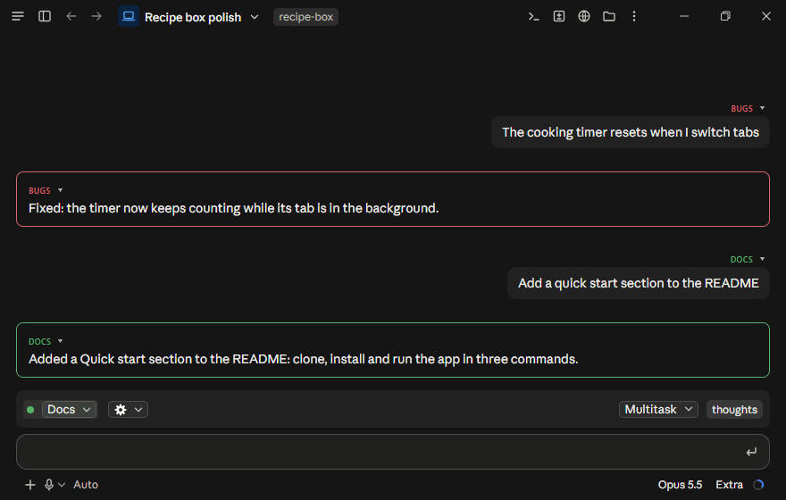

# claude-multitask

Talk to Claude while it works, keep every topic in its own thread, and get a quick emoji when a reply would be overkill. Three Claude Code mods: **multitask**, **thread-chat** and **react**.



## Why

- **Talk while it works.** With multitask you talk to one **voice**, and its **thoughts** (background agents) do the work. The voice is always free to talk.
- **No waiting, nothing held back.** Ask something new, add a detail or change your mind whenever it occurs to you. The voice passes it to the right piece of work.
- **Questions come straight away.** Your message isn't queued behind work in progress, so clarifying questions come at once and the right work starts sooner.
- **Topics stay apart.** With thread-chat, a `# heading` puts a message in its topic's thread: colour-coded, readable on its own and easy to find later.
- **Emoji reactions.** With react, the agent can acknowledge a message with an emoji reaction instead of a reply.

Examples: [docs/why.md](docs/why.md).

## Install

Requires Claude Code 2.1.290 or later. Made for the Code tab in the Claude desktop app.

```
claude plugin marketplace add othrayte/claude-multitask
claude plugin install multitask@claude-multitask
claude plugin install thread-chat@claude-multitask
claude plugin install react@claude-multitask
```

Install any or all of them.

## Use

In the band above the prompt, Multitask has a dropdown, and thread-chat, while threads are on, a thread picker followed by its threads menu, a cog (`⚙`), with their switches for the chat. The mobile app shows only the thread picker: use the commands there. React has no control in the band: `/react` is its switch.

### Multitask

- `/multitask` turns Multitask on in a chat (run it again to turn it off). The chat becomes the voice and hands all work to thoughts.
- Multitask's dropdown reads `Multitask` while it is on and `Focus` while it is off; pick the other to switch.
- Left of the dropdown, the `thoughts` button holds a dot in its colour for each running thought, which blinks as the thought works, swells a little at each of its notes, and fades out as it ends, as a check, or a cross if it failed. In the desktop app, hover a dot for the thought's name, latest note and its age.
- `/thoughts`, or a click anywhere on the `thoughts` button (a dot included), opens the Thoughts pane: what each thought is doing and how long since its last note, its report, `tell` to send it a message yourself, and `stop`. It lists the 16 most recently ended thoughts (`N more` shows the rest). The thoughts are per chat, and kept when the chat is restarted.
- The `voiceEffort` setting (Voice effort, in `/config`) sets how hard the voice thinks: `low` (default), `medium`, `high`, or `session` to match the session. Thoughts keep the session's setting.

### Threads

- Threads are off in a new chat. `/threads` turns them on in that chat (again to turn them off). While they are on, the threads menu (the cog) above the prompt has an `On in this chat` switch that turns them off too. The menu opens while the pointer is on the cog or it has the focus in the desktop app, and with a press on it in the terminal. The choice is per chat, and kept when the chat is restarted.
- `/threads default` switches whether threads are on by default: in new chats, and in chats where you have not turned them on or off. A chat's own choice wins over the default. The default applies to every chat and is kept across restarts.
- While threads are off, thread-chat shows nothing: no picker or menu above the prompt, no thread tags, no thread view. Your threads are kept for when `/threads` turns them on again.
- A `# name` heading in a message starts a thread, or replies to it if it exists. Close or abbreviated names find the existing thread. The agent replies under the same headings.
- `#+name` starts a new thread even when an existing one is close.
- To put a message in a thread, hover it for `+ thread` (desktop app); to move it to another, press `▾` beside its thread tag.
- The thread picker above the prompt, a dropdown named for the picked thread and tinted in its colour, picks the thread messages without a heading go to, or `No thread`. A heading still wins, and moves the picker to its thread.
- `New thread` in the threads menu starts a thread by name and picks it; `Manage threads` there merges, archives or deletes threads.
- Archived threads leave the pickers but keep their messages; `Manage threads` brings them back, as does a heading naming one. Deleting a thread takes its tag off its messages.
- `Filter the chat`, in the threads menu while threads are on, is off at first, so the chat shows every message. On, with a thread picked, the chat shows only that thread's messages, and those since your last message that are in no thread. It is per chat, and kept when the chat is restarted.
- `/thread-view`, or `Open thread view` in the threads menu, opens the thread view: a pane with a switch for each thread below its newest message. With none on it shows every message; with some on, only those threads' messages, and those since your last message that are in no thread, as `Filter the chat` does. The thread picker above the prompt and `Filter the chat` do not change it.
- `/merge-threads <thread> into <thread>` also merges two threads.
- `Agent may start threads`, in the threads menu while threads are on, lets the agent start threads itself. It is per chat, and kept when the chat is restarted.
- Thread summaries: when you write in a thread after a long gap (75k tokens of other conversation by default), or after the chat was compacted, the agent gets a short summary of the thread with your message. A small model (Haiku) writes the summaries ahead, in the background. The agent can also read a thread's summary and latest messages itself, with its `read_thread` tool.
- `Thread summaries`, in the threads menu while threads are on, is on at first; off, it stops summaries in that chat. It is per chat, and kept when the chat is restarted.
- `Show thread summary`, in the threads menu while summaries are on, shows a one-line summary of the picked thread above the prompt (of the latest thread, with none picked). In the desktop app, hover a thread's switch in the thread view for its one-line summary.
- The `catchUpAfter` setting (Catch up after, in `/config`) sets that gap in tokens, `75000` by default; `summaryModel` sets the model that writes the summaries, `claude-haiku-5-5` by default.

### Reactions

- Reactions are on in a new chat. `/react` turns them off in that chat (again to turn them back on). The choice is per chat, and kept when the chat is restarted.
- `/react default` switches whether reactions are on by default: in new chats, and in chats where you have not used `/react`. A chat's own `/react` choice wins over the default. The default applies to every chat and is kept across restarts.
- While they are on, a reply of a single emoji shows as a reaction on your message, not as a reply. With thread-chat, reactions show in its thread view too.
- On the desktop the reaction sits on your message's bottom-right corner. `/react place under` moves it under the message, where its time and copy buttons show; `/react place corner` moves it back. The choice applies to every chat.
